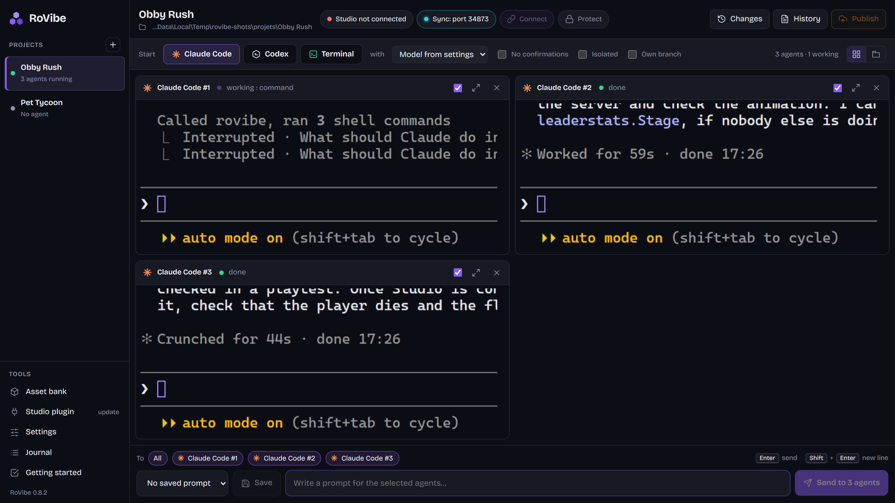
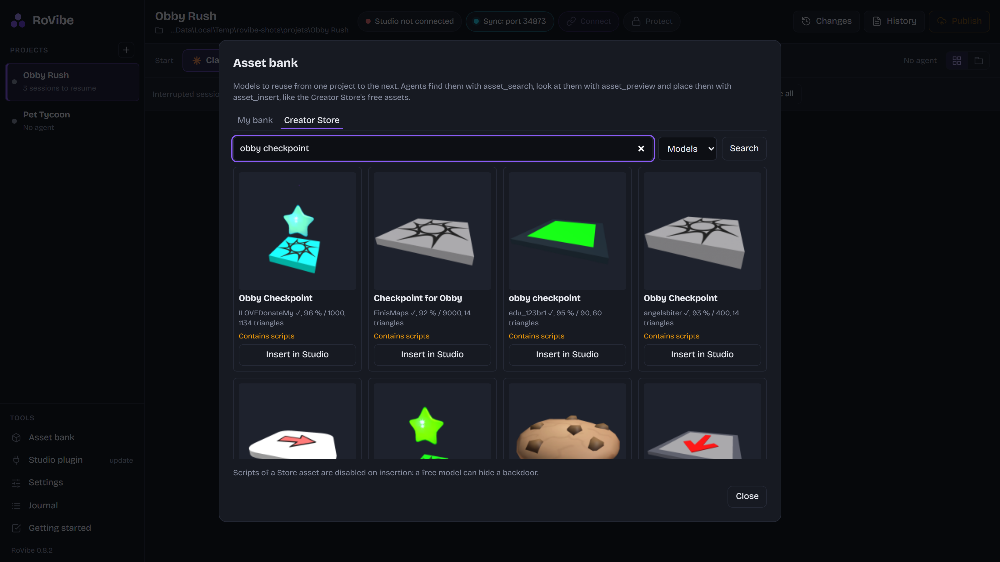
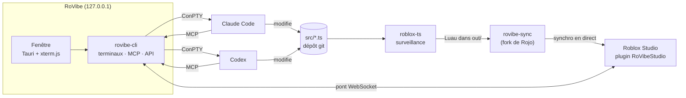

<div align="center">


# RoVibe

### Vibe Code Together in Roblox Studio.

Claude Code et Codex côte à côte sur un même jeu Roblox.<br>
Ils écrivent du TypeScript typé, compilé en Luau à chaque enregistrement. Studio le reflète en direct, et les agents jouent au jeu pour vérifier leur travail.

[](https://github.com/aaldersondev/rovibe/releases/latest)
[](https://github.com/aaldersondev/rovibe/releases)
[](https://github.com/aaldersondev/rovibe/actions/workflows/ci.yml)

[](LICENSE)

[**Télécharger**](https://github.com/aaldersondev/rovibe/releases/latest) · [Fonctions](#fonctions) · [Fonctionnement](#fonctionnement) · [Démarrage](#démarrage) · [Compiler](#compiler) · [English](README.md)

<br>



<sub>Trois agents Claude Code construisent en même temps les checkpoints, le compteur d'étapes et les blocs de lave d'un même obby.</sub>

</div>

---

## Pourquoi RoVibe

- **Plusieurs agents, un seul jeu.** Chaque agent a son terminal dans le dossier du projet. RoVibe les empêche d'écraser les fichiers des autres et peut donner à chacun sa branche git.
- **TypeScript d'abord.** Les nouveaux projets s'écrivent en TypeScript, compilé en Luau par [roblox-ts](https://roblox-ts.com). Chaque appel à l'API Roblox est vérifié avant que le code n'arrive dans Studio, et les agents ont les paquets npm et les erreurs de chaque fichier qu'ils écrivent. Le Luau pur reste à un clic.
- **Studio dans la boucle.** Un fork de [Rojo](https://github.com/rojo-rbx/rojo) synchronise Studio avec les fichiers. Chaque agent reçoit un serveur MCP qui lit le jeu, exécute du Luau, joue le test et prend des captures. Un appel d'outil prend environ 1 ms.
- **Tu gardes la main.** Chaque changement est listé avec l'agent qui l'a fait, et chaque projet est un dépôt git sur lequel on peut revenir en arrière. Publier, ou synchroniser un jeu en ligne, attend ton accord.
- **Ton propre abonnement.** RoVibe ne contient aucun modèle. Chaque agent se connecte avec ton compte Claude ou ChatGPT, et tout tourne sur ton PC.

## Fonctions

### Des agents côte à côte
| | |
|---|---|
| **Sessions** | Claude Code et Codex dans des panneaux côte à côte, ou un à la fois en onglets. On réordonne un panneau en glissant son en-tête. |
| **État** | Chaque panneau indique si son agent travaille, attend ta réponse ou a fini. Windows te prévient quand l'app n'est pas au premier plan. |
| **Verrous** | Un fichier modifié par un agent lui est réservé 10 minutes. Un autre agent qui essaie de le modifier est refusé et apprend qui le tient, tout comme une commande shell qui l'écraserait. Les agents peuvent réserver à l'avance (`claim_files`) et voir qui fait quoi (`agents_status`). |
| **Tour de Studio** | Un seul agent à la fois lance des tests, prend des captures ou joue au jeu dans une place. Les autres apprennent qui pilote et attendent leur tour dans une file (`studio_wait`) au lieu de se gâcher leurs tests. La main se libère seule après 30 s sans action, 3 minutes pendant un test. |
| **Console par agent** | Chaque agent ne reçoit que les lignes de la console qu'il n'a pas encore lues, et le `print` de son `run_luau` ne revient qu'à lui. |
| **Branche à part** | En option, chaque agent travaille dans sa copie du projet, sur sa branche git. Tu lis ses fichiers et son diff, puis tu fusionnes. Une fusion en conflit est annulée et les fichiers concernés sont nommés. |
| **Consignes groupées** | Une consigne part vers plusieurs agents d'un coup. Les consignes fréquentes sont enregistrées dans le projet. |
| **Arrière-plan** | Les agents tournent dans un serveur séparé de la fenêtre. Fermer la fenêtre, mettre l'app à jour ou un plantage n'arrête pas les sessions. |
| **Reprise** | Les sessions Claude Code ouvertes à la fermeture sont proposées au lancement suivant, avec leur conversation. |
| **Isolation** | En option, un agent tourne dans une distribution WSL verrouillée : seul le dossier du projet est visible, et le réseau ne mène qu'à l'API du modèle et aux hôtes que tu autorises. |

### Roblox Studio en direct
| | |
|---|---|
| **TypeScript → Luau** | Le compilateur roblox-ts tourne en surveillance à côté de la synchro : un `.ts` enregistré arrive dans Studio en Luau en une demi-seconde environ. L'en-tête indique si tout compile. Un fichier qui ne compile pas n'arrive jamais dans Studio, et l'agent qui l'a écrit apprend aussitôt pourquoi. Des fichiers `.luau` écrits à la main peuvent cohabiter avec le TypeScript. |
| **RoVibe Sync** | Le code vit dans des fichiers, Studio reflète chaque enregistrement en 100 ms environ. Un nouveau projet part d'un modèle (TypeScript ou Luau) ou des scripts d'une place déjà ouverte dans Studio. Une place porte la marque du projet auquel elle appartient et ne reçoit jamais les fichiers d'un autre, même renommée ou jamais publiée. Quand la connexion tombe, comme au démarrage d'un test, la synchro reprend où elle en était au lieu de tout recharger. |
| **Pont Studio** | Le plugin garde un WebSocket ouvert vers l'app : un seul aller-retour local par appel d'outil, sans polling. Les outils se mettent à jour sans redémarrer Studio. Dans les DataModels d'un test, le plugin ne démarre que ce pont : les tests démarrent aussi vite que sans lui. |
| **Jouer le test** | Les agents lancent un test Play, déplacent le personnage (pathfinding) et envoient touches, clics, texte, molette et mouvements de caméra par VirtualInput, les entrées du moteur Roblox : le jeu les reçoit comme celles d'un joueur. Un clic sur un élément d'interface désigné par son chemin est vérifié : il doit l'avoir vraiment activé. Tout se passe en arrière-plan : ton clavier et ta souris restent à toi. |
| **Vérifier en un appel** | `playtest_check` attend que le code soit compilé et arrivé dans Studio, lance un test neuf, prépare la scène, marche, vérifie, lit les consoles serveur et client, prend une capture et arrête le test, même en cas d'échec. Verdict PASS, FAIL (cause nommée) ou INCONCLUSIVE (code pas garanti à jour). Les scénarios s'enregistrent dans `.rovibe/tests/` pour être rejoués. |
| **Captures** | Roblox rend l'image lui-même (CaptureService), en édition comme dans le client d'un test, sans fenêtre ni focus ; la capture de la fenêtre reste en secours. `frame` place la caméra sous l'angle voulu (azimut, élévation, distance, champ de vision), puis la remet exactement où elle était. `capture_sequence` prend une rafale et la rend en planche-contact horodatée : animations, effets, transitions. |
| **Diagnostics** | `rig_check` (un modèle tient-il ensemble ?), `asset_check` (dimensions, posé ou flottant), `ui_check` (hors écran, texte coupé, boutons trop petits ou superposés) et `selection` (ce que l'utilisateur montre dans Studio). |
| **Vérification du code** | `check_code` donne les erreurs du compilateur dans un projet TypeScript, et lance selene et luau-lsp dans un projet Luau. À chaque fichier écrit par un agent, ses erreurs lui reviennent aussitôt. |
| **Publication** | Un bouton, ou l'outil `publish` après ton accord. RoVibe relit ensuite chez Roblox la date de mise à jour de la place pour confirmer la publication. |
| **Studio bloqué** | Une boîte de dialogue ouverte dans Studio (« Auto Recovery » après un plantage, par exemple) est signalée, et aucun test ne démarre tant qu'elle est là. |

### Banque d'assets
Les modèles enregistrés depuis Studio, chacun avec un aperçu pris à l'enregistrement, rangés en collections et réutilisables d'un projet à l'autre. Un pack entier s'importe d'un coup. L'onglet Creator Store cherche les assets gratuits de Roblox, avec leurs images, et les insère scripts désactivés. Les agents voient les mêmes images avec `asset_preview`.



### Sûr par défaut
| | |
|---|---|
| **Changements** | Tout ce que les agents ont changé depuis ta dernière relecture, commité ou non, avec l'agent responsable et le diff. Chaque fichier s'annule séparément. |
| **Historique** | Chaque projet est un dépôt git. Un point de sauvegarde est créé avant toute session « Sans confirmations », et « Historique » revient à un état antérieur sans rien perdre. |
| **Projet protégé** | Pour un jeu en ligne : Studio montre chaque changement avant de l'appliquer, et un agent doit avoir ton accord pour connecter la synchro, comme pour publier. |
| **Local uniquement** | Tout écoute sur `127.0.0.1`. L'API, le serveur MCP et le serveur de synchro de chaque projet exigent un jeton, et l'entrée du plugin refuse les navigateurs. |

### Outils MCP
Chaque session d'agent reçoit automatiquement le serveur MCP `rovibe`.

| Domaine | Outils |
|---|---|
| Lire le jeu | `get_tree`, `get_instance`, `search`, `get_console`, `selection`, `studio_status` |
| Le modifier | `run_luau` (édition, serveur ou client), `sync_connect`, `check_code` |
| Y jouer | `playtest_check`, `playtest`, `play_move`, `play_input`, `screenshot`, `capture_sequence` |
| Diagnostiquer | `rig_check`, `asset_check`, `ui_check` |
| Assets | `asset_search`, `asset_preview`, `asset_insert`, `asset_save` |
| Publier | `publish` (après ton accord) |
| Travail d'équipe | `agents_status`, `claim_files`, `release_files`, `studio_wait`, `studio_release` |

## Fonctionnement



| Composant | Rôle | Dans ce dépôt |
|---|---|---|
| `rovibe` | L'application desktop | `app/` (fenêtre) et `ui/` (interface), au-dessus de `crates/core` |
| `rovibe-cli` | Le serveur sans fenêtre, et `status` pour interroger un RoVibe lancé | `crates/core/src/main.rs` |
| `rovibe-studio` | Le plugin Roblox Studio (`RoVibeStudio.rbxm`) | `vendor/sync/plugin`, outils dans `crates/core/plugin` |
| `rovibe-mcp` | Le serveur MCP donné à chaque agent | `crates/core/src/mcp.rs` |
| `rovibe-sync` | Le moteur de synchronisation, basé sur Rojo | `vendor/sync` |

## Démarrage

1. **Installe** RoVibe avec l'installeur de la [dernière version](https://github.com/aaldersondev/rovibe/releases/latest) (Windows 10/11, 64 bits). Il n'est pas encore signé : Windows affiche « Éditeur inconnu ». Ensuite, l'app se met à jour toute seule.
2. **Premiers pas** s'ouvre au premier lancement et liste ce qui manque : Claude Code ou Codex, git, Node.js (pour le TypeScript), le plugin Studio. Installe le plugin depuis là, puis redémarre Roblox Studio.
3. **Nouveau projet** : à partir du modèle TypeScript (par défaut) ou Luau, d'un dossier qui contient déjà un `default.project.json` (un projet roblox-ts existant marche tel quel), ou des scripts de la place ouverte dans Studio, qui restent en Luau.
4. **Connecter** : ouvre la place dans Studio et clique sur « Connecter ».
5. **Lance des agents** avec « Claude Code » ou « Codex », et donne-leur quelque chose à construire.

`claude` et `codex` doivent être dans le PATH. La première fois que Codex tourne dans un projet, il demande d'approuver les hooks posés par RoVibe dans `.codex/hooks.json` : ils lui servent à signaler son état et à respecter les verrous.

L'interface existe en anglais et en français. Elle suit la langue du système, ou celle choisie dans les réglages.

## Compiler

Prérequis : Rust, Node 22 et les Visual Studio Build Tools.

```powershell
.\scripts\build.ps1            # app portable dans dist\RoVibe
.\scripts\release.ps1 0.9.0    # installeur signé + latest.json dans dist\release\0.9.0
```

Pour développer sans fenêtre native : `cargo run -p rovibe-core`, puis ouvrir `http://127.0.0.1:34880`.

<details>
<summary><b>Tests</b></summary>

```powershell
cd ui; npm run build; cd ..     # le serveur embarque l'interface
cargo test -p rovibe-core
cd ui; npx playwright install chromium; npm test   # l'interface, dans un vrai navigateur
```

Les tests couvrent ce qui peut faire perdre du travail : import d'une place, verrous entre agents, retour arrière git, fusion de la branche d'un agent, choix du Studio visé, lecture des vérificateurs de code et codes de touches. Les tests d'interface démarrent leur propre serveur, sur un autre port et avec un dossier de réglages vide, et rejouent ce qui a déjà cassé : terminaux qui débordent de leur panneau, panneaux qui se redimensionnent entre eux, réglage refusé qui bloque les suivants, français oublié dans l'interface anglaise. Tout tourne à chaque push.
</details>

<details>
<summary><b>Mises à jour et versions</b></summary>

Au démarrage, l'app lit `latest.json` dans la dernière release GitHub. Si une version plus récente existe, un bandeau propose de l'installer. Seule la fenêtre redémarre : le serveur qui fait tourner les agents garde ses sessions, et la nouvelle version prend le relais quand elles sont fermées, ou tout de suite si tu le demandes. Chaque installeur est signé avec la clé `%USERPROFILE%\.tauri\rovibe.key`, et les copies installées refusent toute mise à jour sans cette signature. Garde la clé hors du dépôt, et sauvegarde-la.

Pousser un tag `v1.2.3` lance `.github/workflows/release.yml`, qui construit cette version et la publie avec `latest.json`. Il lui faut la clé de mise à jour dans le secret du dépôt `TAURI_SIGNING_PRIVATE_KEY`. Sans le secret, le tag ne construit rien. Lancé à la main depuis l'onglet Actions, le workflow essaie seulement la construction et garde l'installeur comme artefact.

```powershell
Get-Content $env:USERPROFILE\.tauri\rovibe.key -Raw | gh secret set TAURI_SIGNING_PRIVATE_KEY --repo aaldersondev/rovibe
git tag v0.9.0; git push origin v0.9.0
```
</details>

<details>
<summary><b>Signature Windows (Authenticode)</b></summary>

Windows ne connaît pas la clé de mise à jour. Sans certificat de signature de code, l'installeur affiche « Éditeur inconnu » et SmartScreen demande une confirmation. Avec un certificat, `release.ps1` signe l'app, le serveur de synchro et l'installeur (par `scripts\sign.ps1`, qui appelle `signtool` du SDK Windows) dès que l'une de ces variables est définie :

```powershell
$env:ROVIBE_SIGN_THUMBPRINT = "<empreinte SHA-1>"   # certificat dans le magasin Windows : clé USB ou HSM cloud
# ou, pour un certificat encore sous forme de fichier :
$env:ROVIBE_SIGN_PFX = "C:\chemin\certificat.pfx"; $env:ROVIBE_SIGN_PFX_PASSWORD = "..."
.\scripts\release.ps1 0.9.0
```

Un certificat s'achète auprès d'une autorité (Certum, Sectigo, DigiCert…) ou se loue via Azure Trusted Signing. Avec un certificat OV, l'avertissement SmartScreen ne disparaît qu'une fois la réputation acquise ; avec un EV, il disparaît tout de suite. Sans variable, la version est construite sans signature.
</details>

<details>
<summary><b>Agents isolés (WSL)</b></summary>

`.\scripts\setup-isolation.ps1` crée la distribution WSL une fois pour toutes. Une session lancée en « Isolé » y tourne. Seul le dossier du projet est monté : aucun disque Windows n'est visible, aucun programme Windows ne peut être lancé, et l'utilisateur de l'agent ne peut pas devenir root. Son réseau est fermé lui aussi. L'utilisateur de l'agent ne joint que la boucle locale de la distribution, où attendent un relais vers l'app et un proxy. Le proxy n'ouvre que des tunnels HTTPS vers l'API du modèle (`anthropic.com`, `claude.ai`, `claude.com`, `openai.com`, `chatgpt.com`) et vers les hôtes ajoutés dans les réglages, comme `github.com`. Pas de DNS ni d'accès direct, et chaque hôte refusé est noté une fois dans le journal. Le réglage « Ouvert » rend tout internet. Chaque agent se connecte une fois à son compte, dans son terminal. Si la distribution a été créée par une version antérieure, relance le script.
</details>

<details>
<summary><b>Où sont les choses</b></summary>

| Chemin | Contenu |
|---|---|
| `%LOCALAPPDATA%\RoVibe` | L'app installée (par utilisateur, sans droits administrateur) |
| `%USERPROFILE%\.rovibe` | Réglages, jeton, projets enregistrés, journal (`rovibe.log`) |
| `Documents\RoVibe` | Nouveaux projets et banque d'assets (`Banque`) |
| `<projet>\.rovibe` | Consignes enregistrées du projet |
| `<projet>\out`, `include` | Le Luau compilé d'un projet TypeScript (non versionné, refait à chaque enregistrement) |
| Port 34880 | L'app ; la synchro de chaque projet utilise 34873 et au-delà |
</details>

## Licence

Le code de RoVibe est sous [licence MIT](LICENSE). `vendor/sync` reste sous MPL-2.0, en tant que fork de Rojo : ses fichiers modifiés doivent être redistribués avec leurs sources.
