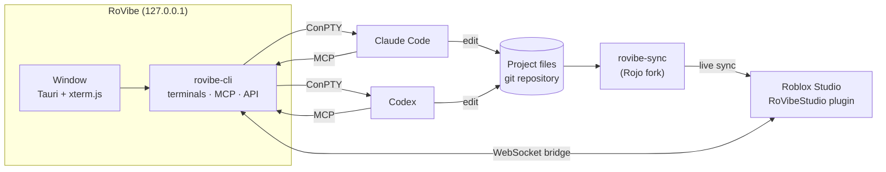

<div align="center">


# RoVibe

### Vibe Code Together in Roblox Studio.

Run Claude Code and Codex side by side on one Roblox game.<br>
They write Luau in real files, Studio mirrors it live, and the agents can play the game to check their work.

[](https://github.com/aaldersondev/rovibe/releases/latest)
[](https://github.com/aaldersondev/rovibe/releases)
[](https://github.com/aaldersondev/rovibe/actions/workflows/ci.yml)

[](LICENSE)

[**Download**](https://github.com/aaldersondev/rovibe/releases/latest) · [Features](#features) · [How it works](#how-it-works) · [Quick start](#quick-start) · [Build](#build-from-source) · [Français](README.fr.md)

<br>


<sub>Three Claude Code agents building a checkpoint system, a stage HUD and kill bricks for the same obby, at the same time.</sub>

</div>

---

## Why RoVibe

- **Several agents, one game.** Each agent gets its own terminal in the project folder. RoVibe stops them from overwriting each other's files, and can give each one its own git branch.
- **Studio in the loop.** A fork of [Rojo](https://github.com/rojo-rbx/rojo) keeps Studio in sync with the files. Every agent gets an MCP server that reads the game, runs Luau, plays the test and takes screenshots. A tool call takes about 1 ms.
- **You stay in charge.** Every change is listed with the agent that made it, and every project is a git repository you can roll back. Publishing, or syncing into a live game, waits for your approval.
- **Your own subscription.** RoVibe includes no model. Each agent signs in with your Claude or ChatGPT account, and everything runs on your PC.

## Features

### Agents side by side
| | |
|---|---|
| **Sessions** | Claude Code and Codex in panes side by side, or one at a time in tabs. Drag a pane's header to reorder it. |
| **Status** | Each pane shows whether its agent is working, waiting for you or done. Windows notifies you when the app isn't in front. |
| **File locks** | A file an agent edits is reserved for it for 10 minutes. Another agent that tries to edit it is refused and told who holds it, and so are shell commands that would overwrite it. Agents can reserve files ahead (`claim_files`) and see who is doing what (`agents_status`). |
| **Own branch** | Optionally, each agent works in its own copy of the project, on its own git branch. Review its files and diff, then merge. A merge that conflicts is undone and the files involved are named. |
| **Shared prompts** | Send one prompt to several agents at once. Save the ones you use often in the project. |
| **Background** | The agents run in a server separate from the window. Close the window, update the app or let it crash: the sessions keep running. |
| **Resume** | Claude Code sessions still open when the app closed are offered again at the next launch, with their conversation. |
| **Isolation** | Optionally, run an agent in a locked-down WSL distribution: only the project folder is visible, and the network only reaches the model's API and the hosts you allow. |

### Roblox Studio, live
| | |
|---|---|
| **RoVibe Sync** | Code lives in files, and Studio mirrors each save in about 100 ms. Start a new project from a template or from the scripts of a place already open in Studio. |
| **Studio bridge** | The plugin keeps a WebSocket open to the app: one local round trip per tool call, with no polling. Tools update without restarting Studio. |
| **Playtesting** | Agents start a Play test, walk the character with pathfinding, and send real keys, clicks, mouse wheel and camera moves, including clicks on an interface element named by its path. All of it happens in the background, so your keyboard and mouse stay yours. |
| **Screenshots** | The app captures Studio's 3D view, even when Studio is behind other windows, and can frame an instance first. |
| **Code checking** | `check_code` runs selene and luau-lsp. Each time a Claude Code agent writes a file, the selene errors go straight back to it. |
| **Publishing** | One button, or the `publish` tool after your approval. RoVibe then reads the place's last update date from Roblox to confirm the publish went through. |
| **Blocked Studio** | An open dialog in Studio (such as "Auto Recovery" after a crash) is reported, and no test starts while it's there. |

### Asset bank
Save models from Studio, each with a preview taken when it's saved, sorted into collections and reusable from one project to the next. Import a whole pack in one go. The Creator Store tab searches Roblox's free assets, with their pictures, and inserts them with their scripts disabled. Agents see the same pictures through `asset_preview`.


### Safe by default
| | |
|---|---|
| **Changes** | Everything agents changed since your last review, committed or not, with the agent responsible and the diff. Undo any file on its own. |
| **History** | Every project is a git repository. A checkpoint is created before any "No confirmations" session, and History goes back to an earlier state without losing anything. |
| **Protected project** | For a live game: Studio shows each change before applying it, and an agent needs your approval to connect the sync, just as it does to publish. |
| **Local only** | Everything listens on `127.0.0.1`. The API and the MCP server need a token, and the plugin's endpoint refuses browsers. |

### MCP tools
Every agent session gets the `rovibe` MCP server automatically.

| Area | Tools |
|---|---|
| Read the game | `get_tree`, `get_instance`, `search`, `get_console`, `studio_status` |
| Change it | `run_luau` (edit, server or client), `sync_connect`, `check_code` |
| Play it | `playtest`, `play_move`, `play_input`, `screenshot` |
| Assets | `asset_search`, `asset_preview`, `asset_insert`, `asset_save` |
| Ship it | `publish` (after your approval) |
| Teamwork | `agents_status`, `claim_files`, `release_files` |

## How it works



| Component | Role | In this repository |
|---|---|---|
| `rovibe` | The desktop app | `app/` (window) and `ui/` (interface), on top of `crates/core` |
| `rovibe-cli` | The server without a window, and `status` to query a running RoVibe | `crates/core/src/main.rs` |
| `rovibe-studio` | The Roblox Studio plugin (`RoVibeStudio.rbxm`) | `vendor/sync/plugin`, tools in `crates/core/plugin` |
| `rovibe-mcp` | The MCP server given to every agent | `crates/core/src/mcp.rs` |
| `rovibe-sync` | The sync engine, based on Rojo | `vendor/sync` |

## Quick start

1. **Install** with the installer from the [latest release](https://github.com/aaldersondev/rovibe/releases/latest) (Windows 10/11, 64-bit). It isn't code-signed yet, so Windows shows "Unknown publisher". After that, the app updates itself.
2. **Getting started** opens on first launch and lists what's missing: Claude Code or Codex, git, the Studio plugin. Install the plugin from there, then restart Roblox Studio.
3. **New project**: start from a template, from a folder that already holds a `default.project.json`, or from the scripts of the place open in Studio.
4. **Connect**: open the place in Studio and click Connect.
5. **Start agents** with Claude Code or Codex, and give them something to build.

`claude` and `codex` must be on the PATH. The first time Codex runs in a project, it asks you to approve the hooks RoVibe put in `.codex/hooks.json`: they report its status and make it respect the file locks.

The interface is in English and French. It follows the system language, or the one chosen in Settings.

## Build from source

Requirements: Rust, Node 22 and the Visual Studio Build Tools.

```powershell
.\scripts\build.ps1            # portable app in dist\RoVibe
.\scripts\release.ps1 0.9.0    # signed installer + latest.json in dist\release\0.9.0
```

For development without the native window, run `cargo run -p rovibe-core`, then open `http://127.0.0.1:34880`.

<details>
<summary><b>Tests</b></summary>

```powershell
cd ui; npm run build; cd ..     # the server embeds the interface
cargo test -p rovibe-core
cd ui; npx playwright install chromium; npm test   # the interface, in a real browser
```

The tests cover what could lose work: importing a place, file locks between agents, going back in git, merging an agent's branch, choosing which Studio to act on, reading the code checkers' output, and key codes. The interface tests start their own server, on another port with an empty settings folder, and replay bugs that once happened: terminals overflowing their pane, panes resizing each other, a refused setting blocking the next ones, French left in the English interface. Everything runs on every push.
</details>

<details>
<summary><b>Updates and releases</b></summary>

On start, the app reads `latest.json` from the latest GitHub release. If a newer version exists, a banner offers to install it. Only the window restarts: the server that runs the agents keeps its sessions, and the new version takes over once they're closed, or right away if you ask. Each installer is signed with the key `%USERPROFILE%\.tauri\rovibe.key`, and installed copies refuse any update without that signature. Keep the key out of the repository, and back it up.

Pushing a tag `v1.2.3` runs `.github/workflows/release.yml`, which builds that version and publishes it with `latest.json`. It needs the update key as the repository secret `TAURI_SIGNING_PRIVATE_KEY`. Without the secret, the tag builds nothing. Run by hand from the Actions tab, the workflow only tries the build and keeps the installer as an artifact.

```powershell
Get-Content $env:USERPROFILE\.tauri\rovibe.key -Raw | gh secret set TAURI_SIGNING_PRIVATE_KEY --repo aaldersondev/rovibe
git tag v0.9.0; git push origin v0.9.0
```
</details>

<details>
<summary><b>Windows code signing (Authenticode)</b></summary>

Windows doesn't know about the update key. Without a code-signing certificate, the installer shows "Unknown publisher" and SmartScreen asks for confirmation. With a certificate, `release.ps1` signs the app, the sync server and the installer (through `scripts\sign.ps1`, which calls `signtool` from the Windows SDK) as soon as one of these variables is set:

```powershell
$env:ROVIBE_SIGN_THUMBPRINT = "<SHA-1 thumbprint>"   # certificate in the Windows store: USB token or cloud HSM
# or, for a certificate that is still a file:
$env:ROVIBE_SIGN_PFX = "C:\path\certificate.pfx"; $env:ROVIBE_SIGN_PFX_PASSWORD = "..."
.\scripts\release.ps1 0.9.0
```

Certificates are sold by certificate authorities (Certum, Sectigo, DigiCert…) or rented through Azure Trusted Signing. With an OV certificate, the SmartScreen warning only goes away once the app has built a reputation; with an EV certificate, it goes away right away. With no variable set, the release is built unsigned.
</details>

<details>
<summary><b>Isolated agents (WSL)</b></summary>

`.\scripts\setup-isolation.ps1` creates the WSL distribution once. A session started as "Isolated" runs there. Only the project folder is mounted: no Windows drive is visible, Windows programs can't be started, and the agent's user can't become root. Its network is closed too. The agent's user can only reach the distribution's own loopback, where a relay to the app and a proxy wait. The proxy only opens HTTPS tunnels to the model's API (`anthropic.com`, `claude.ai`, `claude.com`, `openai.com`, `chatgpt.com`) and to the hosts you add in Settings, such as `github.com`. There is no DNS and no direct access, and each refused host is logged once. The "Open" setting gives back the whole internet. Each agent signs in to its account once, in its terminal. If the distribution was created by an earlier version, run the script again.
</details>

<details>
<summary><b>Where things are</b></summary>

| Path | What |
|---|---|
| `%LOCALAPPDATA%\RoVibe` | The installed app (per user, no administrator rights) |
| `%USERPROFILE%\.rovibe` | Settings, token, registered projects, journal (`rovibe.log`) |
| `Documents\RoVibe` | New projects and the asset bank (`Banque`) |
| `<project>\.rovibe` | Saved prompts of the project |
| Port 34880 | The app; each project's sync uses 34873 and up |
</details>

## License

RoVibe's code is under the [MIT license](LICENSE). `vendor/sync` stays under MPL-2.0, as a fork of Rojo: its modified files must be redistributed with their source.
